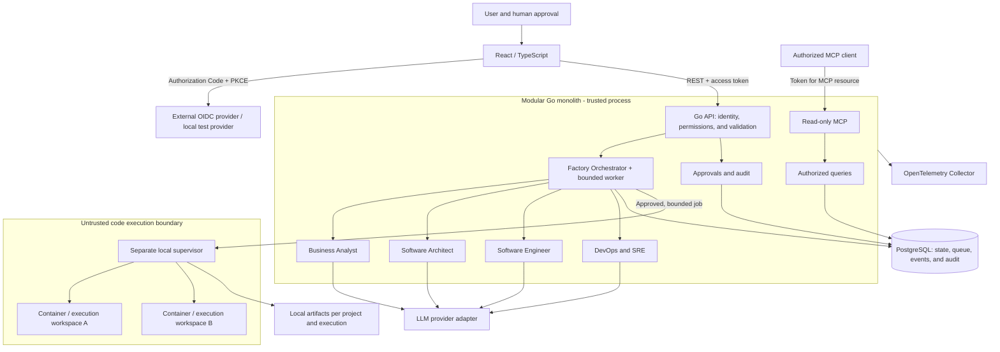

# ForgeFlow IA — architecture proposal

Status: proposed for human review. Date: 2026-11-01.
This proposal does not authorize implementation, deployment, or paid services.

## Purpose and current state

A public software factory demonstration with four agents, traceability, human
review, and reproducible delivery. The repository contains a README, license,
Git exclusions, and design documents; it does not contain a working platform.
The components below are proposed, not implemented.

## Alternatives

| Approach | Benefit | Cost or limitation | Recommendation |
| --- | --- | --- | --- |
| Modular Go monolith + PostgreSQL | Local transactions, small operational footprint | Explicit recovery and coordination | Recommended for two executions |
| Go + durable workflow engine | Specialized history and recovery | Another service and operational model | Revisit if workflows grow |
| Microservices per agent + broker | Independent scaling | Distributed consistency and more operations | Rejected for this demo |

The recommendation is a design proposal pending user approval.

## Proposed structure

Code directories will be created in their respective milestones; this document
does not imply that they already exist. Root `AGENTS.md` provides assistant
instructions now; its engineering rules will be expanded in M1.

```text
forgeflow-ia/
├── AGENTS.md                       # repository and assistant instructions
├── README.md
├── go.mod                          # one Go module
├── cmd/
│   ├── api/                        # HTTP, internal worker, and MCP
│   ├── migrate/                    # explicit migrations
│   └── runner/                     # isolated local supervisor, starting in M4
├── internal/
│   ├── config/
│   ├── httpapi/
│   ├── identity/                   # authentication and authorization
│   ├── projects/
│   ├── orchestration/              # state machine and scheduler
│   ├── agents/                     # analyst, architect, engineer, devops
│   ├── approvals/
│   ├── governance/                 # approved, versioned standards
│   ├── mcp/                        # tools, not agents
│   ├── runner/                     # supervisor client
│   ├── persistence/                # SQL and PostgreSQL pool
│   └── telemetry/
├── migrations/
├── web/                            # React and strict TypeScript
├── contracts/                      # OpenAPI and output JSON Schemas
├── standards/                      # global standards, no project data
├── skills/                         # reusable workflows; no credentials
├── tests/integration/
├── tests/e2e/
├── deploy/local/                   # Compose and test OIDC provider
├── deploy/observability/
├── infra/terraform/modules/
├── infra/terraform/environments/    # dev, test, and prod
├── .github/workflows/
└── docs/
    ├── architecture.md
    ├── requirements.md
    ├── security.md                 # starting in M1, expanded per milestone
    ├── quality-standards.md         # starting in M1
    ├── deployment.md               # starting in M1
    ├── operations.md               # starting in M1
    ├── roadmap.md
    ├── milestone-1.md
    └── adr/
```

## High-level diagram



The API process receives no Docker socket and does not mount the host repository
for code execution. The supervisor is a local privilege boundary, not a business
microservice. It receives jobs over an authenticated, host-restricted channel;
it accepts only permitted job templates, never arbitrary commands from HTTP or
MCP. The supervisor controls the runtime; child containers receive neither its
credentials nor its socket. Local Docker reduces exposure but does not provide
sufficient isolation for arbitrary code from the Internet. The demo will run
privately/locally, with requests from a trusted operator.

## Workflow and contracts

1. The user creates a project and execution. Identity comes from the token,
   never from a client-supplied `owner_id`.
2. The analyst produces structured, versioned requirements and acceptance
   criteria validated against JSON Schema; blocking questions need human input.
3. The user approves requirements; the architect produces alternatives and ADRs.
4. The user approves architecture and work scope before code generation or
   execution. The engineer works in a server-assigned workspace.
5. DevOps/SRE prepares delivery files and runs permitted validations.
6. The user reviews the package. COMPLETED means validated and approved delivery;
   it does not mean deployed. Cloud provisioning or publishing needs separate authorization.

Each output includes schema version, project, execution, attempt, input
references, standards version, and model used. Validation and approval are
orchestrator controls, not decisions the model can bypass. Invalid results are
recorded and may be retried within budget.

## Data model and transactions

| Proposed table | Content and invariants |
| --- | --- |
| projects | UUID, owner `issuer + subject`, name, request, timestamps |
| project_requirements | Project, version, validated content, approval; UNIQUE project/version |
| executions | Project, state, stage, budget, lease, concurrency version |
| agent_executions | Project, execution, agent, attempt, state, inputs/outputs, sanitized error |
| execution_events | Project, execution, sequence, state, timestamp; UNIQUE execution/sequence |
| approval_requests | Project, execution, stage, artifact version/hash, resolution, actor |
| architecture_decisions | Project, version, decision, alternatives, approval |
| audit_records | Actor, action, resource, outcome, correlation; no secrets or full prompts |
| idempotency_keys | Actor, operation, key, payload hash, response, expiration |

`executions` represents the complete workflow; `agent_executions` represents each
stage attempt. The proposal allows one nonterminal execution per project, with
two projects running concurrently. The `executions` table also serves as the
persistent queue; no Redis or broker is introduced.

All child relationships carry `project_id`; composite foreign keys prevent
references to another project's execution. Queries filter by authorized owner
and project, even when a UUID is known. Indexes:
projects(owner_issuer, owner_subject, created_at), executions(state, available_at),
agent_executions(project_id, execution_id), execution_events(execution_id, sequence),
and approval_requests(project_id, status). CHECK constraints cover states and
positive limits; a partial unique index enforces one active execution per project.

Short transactions cover: project creation + audit; execution creation + event +
idempotency; job claim + lease; result + transition + event; approval resolution +
audit + requeue. Never hold transactions open during model calls, code execution,
or human review. Results are committed only when lease, attempt, and concurrency
version match.

## Coordination and recovery

Workflow states: CREATED → QUEUED → RUNNING → WAITING_APPROVAL.
Approval returns the execution to QUEUED for the next stage; final approval leads
to COMPLETED. Rejection leads to CANCELLED; a revision starts a new execution
referencing the previous one. RUNNING may transition to QUEUED for a transient
retry or FAILED for a permanent error/exhausted budget. CREATED, QUEUED, RUNNING,
and WAITING_APPROVAL permit CANCELLED. Terminal states are immutable; rerunning
a workflow creates a new execution.

The worker claims rows with a short lock, renewable lease, and recovery after
expiration. One demo scheduler limits work to two active stages; each workflow
uses one agent at a time, and WAITING_APPROVAL releases its slot. A second
API/worker replica is unsupported in the MVP and must be prevented through
configuration. Timeouts and cancellation propagate to the provider and supervisor.
Late results are discarded by version; an old approval cannot authorize new
artifacts. Each retry requires a stable operation key.

Configurable proposal: at most three attempts per stage, exponential backoff
with jitter, 120 s model timeout, 10 min job timeout, and a maximum execution
budget. External effects with uncertain outcomes are not retried automatically.
At-least-once semantics with deduplication; exactly-once is not promised.

## Identity, tools, and isolation

SPA with Authorization Code + PKCE S256; access tokens held in memory. The backend
validates signatures using trusted JWKS, allowed algorithms, issuer, audience,
and time claims. It does not accept ID tokens as API credentials. Proposed roles:
viewer (read), operator (create/start/cancel), and approver (resolve gates).
All also require project access; a role does not grant global access. A demo
operator may hold all three roles, without claiming separation of duties.

Read-only MCP: `get_project_requirements`, `get_engineering_standards`,
`list_architecture_decisions`, `get_execution_status`. Bounded contracts,
per-request identity, and project authorization. The MCP resource verifies its
audience; it does not forward tokens to providers or tools. The specific
SDK/transport mechanism will be fixed in M5 against the selected compatible specification.

Model credentials remain in the control plane; jobs receive no cloud/DB
credentials. Each execution has an assigned workspace, non-root user, read-only
base filesystem, reduced capabilities, resource limits, no host mounts, and
network disabled by default. Dependency installation requires a controlled build
phase with pinned dependencies, caching, and permitted destinations. The API
validates paths; the supervisor rejects traversal and links outside the workspace.

## Operations and limitations

Bounded PostgreSQL pool; separate migration and runtime users. Local DB ports
are not published by default; TLS and certificate verification apply outside
the local environment. Backups and restoration are documented and rehearsed
before claiming recoverability. Runtime permissions enforce append-only audit
records, without promising immutability against a database administrator.

JSON logs and OpenTelemetry carry request/trace/execution IDs, without tokens or
sensitive bodies. HTTP request volume, latency, and error metrics; queue, lease,
and stage metrics. Do not use project IDs as high-cardinality metric labels.
Initial demo targets, not an SLA: 99% of valid API requests without 5xx and p95
below 500 ms over a 7-day window, excluding model/job time. Jobs: 95% of eligible
stages start within 10 s when capacity is available. Targets will be measured
in M7/M8; there is no evidence of compliance yet.

## Design references

- [PostgreSQL SELECT](https://www.postgresql.org/docs/current/sql-select.html):
  `SKIP LOCKED` supports consumers of a queue-like table; it does not replace a
  general-purpose consistent view. Its use here is a proposal.
- [OAuth Security BCP, RFC 9700](https://www.rfc-editor.org/info/rfc9700/):
  reference for PKCE and audience restrictions.
- [MCP security considerations](https://github.com/modelcontextprotocol/modelcontextprotocol/blob/main/docs/specification/2026-07-28/basic/authorization/security-considerations.mdx):
  reference for resource-bound tokens and the prohibition of token passthrough.

## Requested review

Approve or revise the five proposed ADRs, MVP boundaries, and M1 criteria.
The LLM provider, specific dependency versions, and cloud destination will be
selected in their respective milestones; they do not block M1. Cloud resources
will not be provisioned without subsequent explicit authorization.
